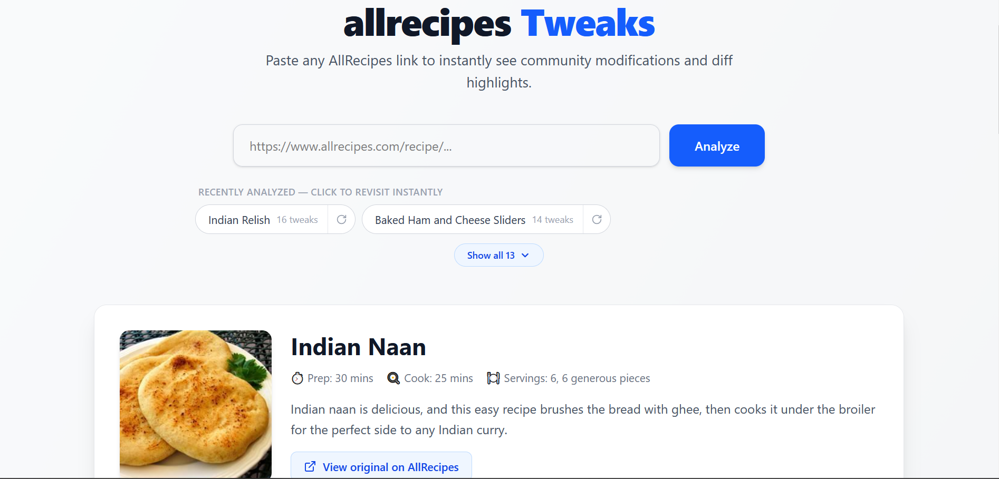

# 🍳 Allrecipes Tweaks

## 📸 Screenshot



Paste any [AllRecipes](https://www.allrecipes.com) link and instantly see how home cooks modified the recipe — with **GitHub-PR-style visual diffs** highlighting every added, removed, and changed ingredient or step.

Built in 12 hours from start to production.

## 🔗 Live Links

| What | Where |
|---|---|
| **Frontend** | https://allrecipes.lapwork.in (hosted on Vercel) |
| **Backend API** | https://allrecipes-backend.lapwork.in (self-hosted, behind Cloudflare Tunnel + nginx) |
| **API health** | https://allrecipes-backend.lapwork.in/health |
| **DB latency** | https://allrecipes-backend.lapwork.in/health/db |

## ✨ What It Does

1. User pastes an [AllRecipes URL](https://allrecipes.com)
2. Backend scrapes the recipe (JSON-LD) and pulls **every** review via the AllReviews API
3. Each review runs through **Gemini 3.5 Flash Lite**, which extracts structured diffs (added / removed / changed / note)
4. Every diff is validated against the real recipe lines — hallucinated lines get dropped
5. Frontend renders a switcher tab per tweak, lighting up changes like a code review
6. Everything is **persisted in Postgres** so recipes can be revisited instantly later

## 🏗️ Architecture

```
┌────────────────┐      ┌──────────────────────────┐      ┌──────────────────┐
│  Vercel        │      │  Self-hosted server      │      │  Neon Postgres   │
│  React 19 UI   │ ───▶ │  Cloudflare Tunnel       │ ───▶ │  (serverless)    │
└────────────────┘      │   → nginx                │      └──────────────────┘
                        │   → Bun + Express 5      │
                        │     (systemd, loopback)  │
                        └──────────────────────────┘
                               │
                               ├── Playwright / curl ──▶ allrecipes.com (HTML + reviews API)
                               └── fetch ─────────────▶ Gemini 3.5 Flash Lite (diff extraction)
```

The API binds only to `127.0.0.1`. The only public entry point is the Cloudflare Tunnel → nginx; TLS ends at Cloudflare, and nginx forwards `X-Forwarded-*` headers that the app trusts from loopback only.

### Scraping engines

AllRecipes answers plain HTTP clients with a 402 bot wall. `SCRAPER_ENGINE` picks how the backend gets past it:

- `curl` (default, local dev) — shells out to `curl` with a full Chrome header set.
- `playwright` (production) — drives a real headless Chromium, which gets through where the server's IP is blocked for `curl`.

## 🧰 Tech Stack

| Layer | Tech |
|---|---|
| Frontend | React 19, Vite 8, Zustand, Tailwind CSS 4, TypeScript |
| Backend | Bun, Express 5, Zod 4, TypeScript |
| Database | Neon serverless Postgres + Prisma 7 (adapter-pg) |
| LLM | Gemini 3.5 Flash Lite via OpenAI-compatible endpoint (raw fetch, no SDK) |
| Scraping | Playwright (headless Chromium) in production, curl locally |
| CI/CD | GitHub Actions → Tailscale → SSH deploy (backend), Vercel Git integration (frontend) |
| Hosting | Self-hosted Linux server + systemd + nginx + Cloudflare Tunnel (backend), Vercel (frontend) |

## 📁 Repo Structure

```
PlankRecipe/
├── apps/
│   ├── backend/      # Bun + Express API (see apps/backend/README.md)
│   └── web/          # React + Vite UI (see apps/web/README.md)
├── packages/
│   └── shared/       # TS contracts shared by both apps (see packages/shared/Readme.md)
├── package.json      # Bun workspaces root
├── turbo.json        # Turborepo task pipeline
└── .github/
    └── workflows/
        └── deploy-backend.yml   # Tailscale + SSH deploy to the backend server
```

## 🚀 Running Locally

**Prereqs:** [Bun](https://bun.sh), Node.js 20+, Git

```cmd
git clone https://github.com/binaryrishabh/PlankRecipe.git
cd PlankRecipe
```

Install everything once from the repo root (Bun workspaces, single `bun.lock`):

```cmd
bun install
copy apps\backend\.env.example apps\backend\.env
:: edit apps\backend\.env with your DATABASE_URL + GEMINI_API_KEY
cd apps\backend && bunx prisma generate && cd ..\..
```

Run both apps together via Turborepo — backend on `http://localhost:3000`, frontend on `http://localhost:5173`:

```cmd
bun run dev
```

Or just one: `bun run dev --filter=backend` / `bun run dev --filter=frontend`.

## 🔑 Environment Variables

**Backend** (`apps/backend/.env`):

| Var | Purpose |
|---|---|
| `HOST` | Bind address (default `127.0.0.1`) |
| `PORT` | API port (default 3000) |
| `NODE_ENV` | `development` / `production` |
| `DATABASE_URL` | Neon pooled connection string |
| `DIRECT_URL` | Optional — Neon direct connection, used only by Prisma migrations (falls back to `DATABASE_URL`) |
| `GEMINI_API_KEY` | Google AI Studio key |
| `CORS_ORIGIN` | Allowed origins, comma-separated |
| `SCRAPER_ENGINE` | `curl` (default) or `playwright` |

In production these live in a root-only env file on the server (not in the repo) and are loaded by the systemd unit.

**Frontend** (`apps/web/.env`):

| Var | Purpose |
|---|---|
| `VITE_API_URL` | Backend URL (defaults to `http://localhost:3000`) |

## 🔄 CI/CD — Decoupled Pipelines

Pushes only trigger what actually changed:

| Push touches | What runs |
|---|---|
| `apps/backend/**`, `packages/shared/**`, `package.json` or `bun.lock` | GitHub Actions joins the tailnet → SSH (host key pinned) → `git reset --hard origin/main` → `bun install` → `prisma migrate deploy` → `systemctl restart` → `/health` + `/health/db` checks |
| `apps/web/**` or `packages/shared/**` | Vercel builds + deploys (root directory `apps/web`; unchanged projects are skipped) |

The backend server is never edited by hand — every change ships by pushing to `main`. The deploy can also be started manually from the Actions tab.

GitHub repo secrets: `TS_OAUTH_CLIENT_ID`, `TS_OAUTH_SECRET` (Tailscale OAuth client, tag `tag:allrecipes-ci`), `EC2_HOST`, `EC2_USER`, `EC2_SSH_KEY`, `EC2_HOST_FINGERPRINT`.

## ⚠️ Known Edge Cases

- Reviews are capped at 50 per recipe (one API page — fully covers the Featured Tweaks section)
- Praise-only reviews with zero modifications are hidden rather than shown as blank tabs
- Recipes with unusual JSON-LD nesting fall back to a recursive search; truly broken pages return a clear error instead of crashing

## 📄 License

Private take-home assignment — all rights reserved.